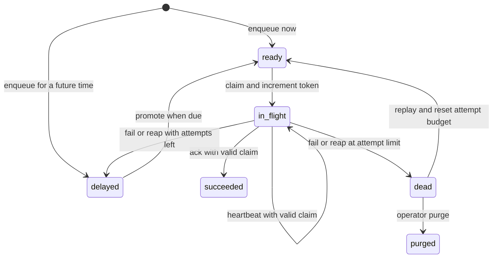

# ReliQ design

The queue, worker runtime, retries, dead-letter recovery, operator API and CLI, and transfer demo are implemented through Phase 6.

## Delivery and ownership

Redis is the source of truth for live jobs. PostgreSQL holds audit history, the dead-letter archive, and the idempotency records and side effects for the demo. A worker can commit a side effect and crash before acknowledging Redis, so the next worker may execute the same handler. ReliQ uses **at-least-once delivery with idempotent handlers for effectively-once side effects**, subject to Redis durability and the configured attempt budget.

Each job has at most one valid claim in Redis at a time. A paused or partitioned worker can continue executing after its lease expires and overlap with a new worker. Fencing protects queue state. A handler must also use idempotency or an external system that enforces fencing to protect its own side effects.

## Job state machine

`succeeded` keeps a terminal hash for inspection. `purged` is an audit event after removing a dead job's hash and index entry. Completed hashes need a retention policy before sustained production use. Job IDs are UUIDs and are never assigned to unrelated jobs. Replay preserves the ID so previously committed idempotent steps stay committed.

## Redis keys

Keys use `reliq:{queue}:…`, where `queue` is a validated name containing letters, digits, hyphens, or underscores. Each state index uses the job ID as its member. The initial deployment targets a single Redis instance.

| Key                         | Type       | Contents                                                        |
| --------------------------- | ---------- | --------------------------------------------------------------- |
| `reliq:{queue}:ready`       | Sorted set | Priority rank and original enqueue time packed into the score   |
| `reliq:{queue}:delayed`     | Sorted set | Eligible execution time in epoch milliseconds                   |
| `reliq:{queue}:in_flight`   | Sorted set | Lease deadline in epoch milliseconds                            |
| `reliq:{queue}:dead`        | Sorted set | Dead time in epoch milliseconds                                 |
| `reliq:{queue}:job:<jobId>` | Hash       | Payload, state, attempt budget, retry policy, and current claim |
| `reliq:{queue}:dlq_archive` | Stream     | Pending PostgreSQL archive writes for dead and replay events    |
| `reliq:{queue}:purged`      | Set        | IDs retained after purge to prevent reuse within a queue        |

The job hash holds `payload` (JSON), `type`, `priority`, `enqueuedAt`, `runAt`, `attempts`, `maxAttempts`, `status`, `lastError`, `stack`, `workerId`, `claimId`, `fencingToken`, and `replayCount`, plus the retry policy resolved for the job type at enqueue. The hash and state index change together. Ready, delayed, in-flight, and dead jobs occupy exactly their corresponding index. A succeeded job has no state index entry. Lease deadlines live in the in-flight sorted set.

The `dlq_archive` stream never holds live queue state.

The ready score is `priorityRank * 10_000_000_000_000 + enqueueTimeMs` with high `0`, normal `1`, and low `2`. An enqueue timestamp below `10_000_000_000_000` keeps the priority bands separate and the largest score below `30_000_000_000_000`. Redis scores represent integers exactly through `2^53` (`9_007_199_254_740_992`). Validate that the timestamp still fits before packing the score. Redis breaks equal-score ties lexicographically by member, so jobs enqueued in the same millisecond with the same priority can run out of insertion order. A sustained higher-priority backlog can starve lower-priority jobs. [Redis ZADD](https://redis.io/docs/latest/commands/zadd/)

Promotion deliberately reuses `readyScore` from the original enqueue. Once eligible, an older scheduled job can move ahead of newer ready jobs of the same priority. `runAt` controls eligibility, and the original enqueue timestamp controls ordering within the priority band.

## Lua transition contracts

Each script derives epoch milliseconds from `redis.call('TIME')`. A client can pass an absolute `runAt` or a relative `delayMs`, and Redis decides whether the result is already due. Keep each script bounded to one candidate job. A caller can scan candidates in small batches and pass each hash key explicitly in `KEYS`. The script rechecks current membership, status, and eligibility before changing state. This keeps the candidate read safe under contention and bounds the time Redis spends executing each script. Lua isolates transitions from competing commands. Validate inputs and state before the first write because script errors do not roll back earlier writes. [Redis Lua scripting](https://redis.io/docs/latest/develop/programmability/eval-intro/) · [Redis EVAL key arguments](https://redis.io/docs/latest/commands/eval/)

| Script       | Validation and effect                                                                                                                                                                                                    | On a repeat call                                                                                                                      |
| ------------ | ------------------------------------------------------------------------------------------------------------------------------------------------------------------------------------------------------------------------ | ------------------------------------------------------------------------------------------------------------------------------------- |
| `enqueue`    | Require an unused ID. Create the hash with `attempts=0`, `fencingToken=0`, and `replayCount=0`. Insert into ready or delayed.                                                                                            | Existing ID is a conflict. The original job stays intact.                                                                             |
| `promoteDue` | Require a delayed job with a score at or before Redis time. Move it to ready using its priority and enqueue timestamp.                                                                                                   | Return an unchanged result once membership is gone.                                                                                   |
| `claim`      | Require that the supplied ready candidate is still the head. Set worker and deadline, increment both `attempts` and `fencingToken` using `HINCRBY`, and move to in-flight. Return payload, attempt, token, and deadline. | On contention, return the current head so the caller can retry immediately. Return empty only when Redis observes an empty ready set. |
| `heartbeat`  | Require the active claim and `deadline > now`. Extend the deadline to the later of the existing deadline and `now + visibilityTimeoutMs`.                                                                                | A valid repeat can extend the lease.                                                                                                  |
| `ack`        | Require the active claim and `deadline > now`. Remove the lease, clear the claim fields, and mark succeeded.                                                                                                             | Return an invalid-claim result. No second ledger event.                                                                               |
| `fail`       | Require the active claim and `deadline > now`. Record the error and stack. Remove the lease and schedule a retry or enter dead.                                                                                          | Return an invalid-claim result. No second retry or archive event.                                                                     |
| `reap`       | Require in-flight status and the current `deadline <= now`. Record lease expiry and use the same retry or dead-letter transition as `fail`.                                                                              | A renewed lease is skipped. An already reaped job stays where it moved.                                                               |
| `replay`     | Require dead status and the expected `replayCount`. Reset `attempts` and error fields, increment `replayCount`, and move to ready. Preserve `fencingToken`.                                                              | Return a conflict if the dead generation has changed or the job has left dead.                                                        |

An active claim is the tuple `(jobId, workerId, fencingToken, claimId)`, with `claimId` a fresh UUID generated for that claim request. The scripts compare the token as a decimal string read back from the hash after `HINCRBY`, preserving the full integer beyond Lua and JavaScript's safe integer range. The extra claim ID distinguishes claims even if a hard crash rolls back an unflushed counter increment and Redis later issues that same token again. Owner operations map missing hashes to a typed missing-job error and stale, expired, or completed claims to a typed invalid-claim error. Non-owner transitions have no fencing credential and use their own state and generation checks. An index member without a hash is an invariant violation that should be logged for repair.

## Worker and maintenance loops

Each worker runs one handler at a time and runs `promoteDue` and `reapExpired` periodically in a concurrent maintenance loop. Multiple workers can run maintenance safely because Lua rechecks the current state and deadline. The reaper scans a bounded batch ordered by expiry using Redis time, and the script rechecks each candidate after the scan. Maintenance runs while handlers are awaiting I/O. A CPU-bound handler on the same event loop can delay heartbeats and maintenance.

On SIGTERM or SIGINT the worker stops submitting new claims and stops scheduling maintenance. A claim already sent to Redis can join the drain. The worker keeps heartbeating and can acknowledge the active job until the drain budget expires. If the budget expires, it signals cancellation and the process exits with outstanding leases left for another live worker to reap. A failed heartbeat signals cooperative cancellation and the worker skips acknowledgement when it detects ownership loss. The Lua ack check remains the authority on ownership.

A handler exception invokes `fail` immediately while the worker owns its lease. The reaper handles abandoned or unconfirmed claims after expiry. Both transitions consume the attempt counted at claim and share the retry calculation. `JOB_RETRY_POLICIES` maps job types to partial settings. Defaults are three attempts, a 500 ms base, a 30,000 ms cap, and up to 250 ms of jitter. Enqueue snapshots the resolved policy, and existing jobs without delay settings use the default timing while preserving their original attempt budget.

The retry delay is `min(baseDelayMs * 2^attempt + jitter, maxDelayMs)` with attempt `1` on the first claim and integer jitter sampled uniformly from zero through `jitterMs`. Lua calculates `runAt` from Redis time. Retries at the cap can still coincide. On exhaustion, Redis records the final error, optional stack, and attempt count in the live DLQ and emits an archive snapshot. `listDead` returns a page of live DLQ entries. Concurrent replays can move entries between pages. Replay uses the selected generation, retains the job ID and fencing counter, and resets the attempt budget. Bulk replay handles up to 100 selections per call and reports an outcome per selection.

## Operator views and purge

Depth reports `ready`, `delayed`, `inFlight`, and `dead` from a single Redis transaction. In-flight inspection reads each lease and worker atomically, calculates time remaining from Redis time, and clamps expired leases to zero. Inspection pages can shift under concurrent transitions. An indexed entry that has already moved can be omitted from a page.

Purge requires a dead job and the selected `replayCount`. The script records the ID in the queue's purged set and deletes the live hash and index entry. Archived records and pending archive events are retained. The reservation prevents a caller from re-enqueueing the same ID into the same queue and colliding with archived generations. Job IDs identify jobs globally, including in PostgreSQL history and idempotency records. Producers that supply their own IDs must keep them unique across queues. The purged set grows with the number of purges.

## PostgreSQL and asynchronous writes

- `jobs_ledger` records transitions append-only at the application level. A stable, unique `event_id` makes a retried insert safe. Timestamp `at` comes from the Redis transition. Include queue, job ID, attempt, and recovery-relevant details such as the original enqueue payload and schedule at enqueue time. Order a job's history by `at` and `id`, and treat timestamps and insert order as evidence when reconciling concurrent processes.
- The worker process hands transition events to its bounded in-memory ledger buffer without awaiting PostgreSQL. Other callers can pass the same recorder when creating a queue. The writer retries with capped exponential backoff and jitter. When its buffer reaches 1,000 entries, it drops incoming events and logs the count at most every ten seconds. Shutdown, process death, and a prolonged outage can leave gaps.
- `dead_letter` archives each `(job_id, replay_count)`. A dead transition appends its snapshot to the Redis archive stream in the same script. A replay records `replayed_at` for the prior generation via that stream. Background writers apply events from oldest to newest and remove individual entries only after PostgreSQL commits. Concurrent writes and redelivery are safe because writes are idempotent. An outage can grow the stream, so monitor the oldest pending event and the backlog. Operators inspect and replay the live Redis DLQ even when the archive is behind. Migration `003` stores archive payloads and ledger details as PostgreSQL `json` so JSON string escapes survive unchanged. [PostgreSQL JSON types](https://www.postgresql.org/docs/16/datatype-json.html)
- `idempotency_keys` uses a composite primary key `(job_id, step_key)`. In each debit, credit, or receipt transaction, attempt `INSERT ... ON CONFLICT DO NOTHING RETURNING ...`. Apply the side effect only if the insert returned a row and commit both together. Roll back both if the effect fails. Each step gets its own key. A transfer can be partially applied between steps and needs operator recovery if it reaches dead. Balances use integer cents. The demo models a receipt as a PostgreSQL row. A real send would need a provider accepting an idempotency key or a transactional outbox paired with downstream deduplication.

The plain SQL migration runner applies pending files and records their checksums in one PostgreSQL transaction. A transaction-scoped advisory lock serializes concurrent runners. Once applied, migration files are immutable. Add a new numbered file for changes. [PostgreSQL advisory lock functions](https://www.postgresql.org/docs/16/functions-admin.html#FUNCTIONS-ADVISORY-LOCKS)

## Crash measurement

The transfer writes its step key and effect in one PostgreSQL transaction. The debit transaction persists the transfer and subtracts funds. Credit uses the committed transfer and the final transaction creates the receipt row. Each committed effect adds an audit row in that same transaction. The audit table deliberately accepts duplicate rows, so it can reveal repeated applications. Handler starts have their own table and may legitimately repeat. Account balances and receipt counts independently check the effect audit totals.

The seeded harness picks a worker and a short pause at the debit checkpoint, then sends SIGKILL. Five replacement workers process the backlog. After the final batch of acknowledged enqueues, the harness invokes `docker restart` in the graceful scenario and `docker kill --signal SIGKILL` in the hard-crash scenario. Recent writes in the hard scenario can survive if the host and its page cache remain running. This experiment measures process death and restart on that host. A host power loss or storage failure has a different durability boundary.

The producer journals every acknowledged job ID. Completion requires a committed receipt and either an observed worker acknowledgment or terminal success in Redis. Once the queue drains or the observation window ends, missing completed IDs are reported as lost for that run. A Redis rollback can make a previously observed success claimable again. The handler step keys prevent reapplying its committed effects. Mutation tests remove the token comparison and expiry guard in temporary copies and verify that each changed guard causes its targeted test to fail.

## Failure modes

| Failure                 | What happens                                                                                                     | Residual risk and recovery                                                                                                                                   |
| ----------------------- | ---------------------------------------------------------------------------------------------------------------- | ------------------------------------------------------------------------------------------------------------------------------------------------------------ |
| Worker crash            | Its lease expires. The reaper retries with backoff or marks the job dead.                                        | A committed side effect can be replayed. Reuse the original job ID for idempotency.                                                                          |
| Redis restart           | AOF loads from the named volume. The client reconnects. Expired claims are reaped when Redis is ready.           | A hard crash can lose recent writes. Reconcile affected job IDs against the archive, ledger, and producer records.                                           |
| PostgreSQL down         | Queue transitions continue in Redis. Ledger events retry in memory and dead-letter archive events wait in Redis. | The ledger buffer can overflow or disappear with its process. Jobs that need PostgreSQL must retry or reach dead. The archive backlog consumes Redis memory. |
| Slow job outlives lease | If heartbeats fail to extend the lease in time, the job becomes eligible for reaping.                            | The old handler may still run. Cancellation is cooperative. Protect effects with idempotency or downstream fencing.                                          |
| Zombie worker           | `ack`, `fail`, and `heartbeat` reject an expired lease or a mismatched claim, including before the reaper runs.  | Fencing applies to operations that check the credential. An external service must supply its own protection.                                                 |
| Poison job              | Failures consume the configured attempt budget. Backoff and jitter spread retries before the job reaches dead.   | Replay only after addressing the cause. Bulk replay can create fresh load on a struggling dependency.                                                        |
| Clock issues            | Scripts use Redis wall time, so client skew has no effect on lease math or relative delays.                      | A Redis clock jump forward may expire leases early. A backward jump may postpone due work and lease expiry. Keep host time synchronized.                     |

## Durability and reconciliation

Compose enables `appendonly yes` and `appendfsync everysec`. On a hard crash, Redis can lose roughly one second of acknowledged writes under normal disk conditions. A missing enqueue can lose a job, a missing ack can bring a completed job back, and a missing claim can roll back its counter increment. The named volume protects data across ordinary container recreation. Deleting or losing the volume removes that protection. A lost network reply also leaves the caller uncertain whether a command ran. The Redis client disables offline queuing and automatic resending so callers handle that uncertainty explicitly. [Redis persistence](https://redis.io/docs/latest/operate/oss_and_stack/management/persistence/) · [ioredis reconnect behavior](https://github.com/redis/ioredis#auto-reconnect)

After a suspected rollback, pause producers and workers for the affected queue before making repairs. Compare Redis job hashes and indexes with recent ledger entries, dead-letter rows, and producer job IDs. For an enqueue present in the ledger or producer record but absent in Redis, recover its payload and verify business state before re-enqueueing with the original ID. For a restored job whose handler already committed, use the idempotency records to safely rerun it or resolve it explicitly. A ledger row can be missing or late, and the ledger may not have all data needed for recovery. Use producer records or backups for gaps. The planned chaos tests can show zero losses in a controlled restart scenario. That result cannot establish zero loss under arbitrary hard crashes with this fsync policy.
